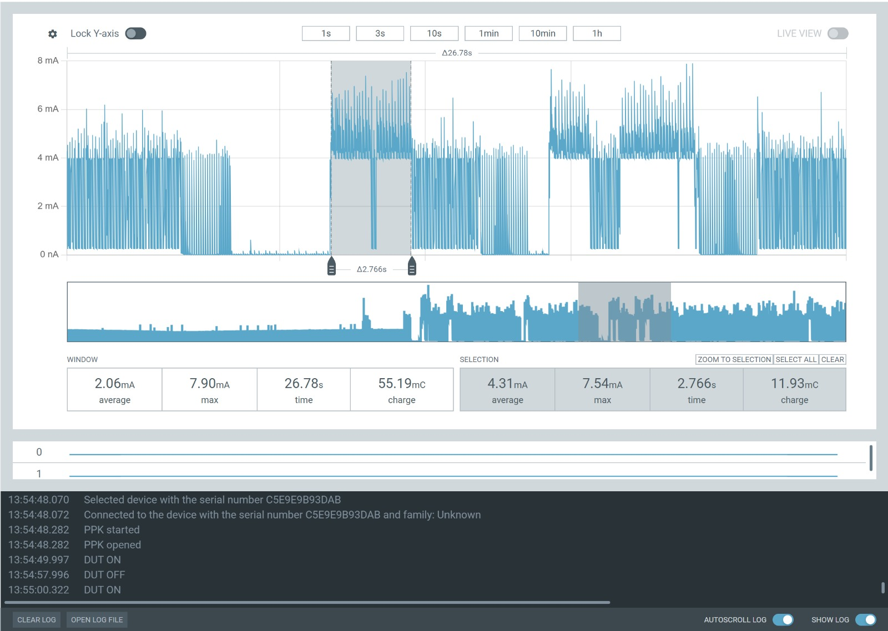
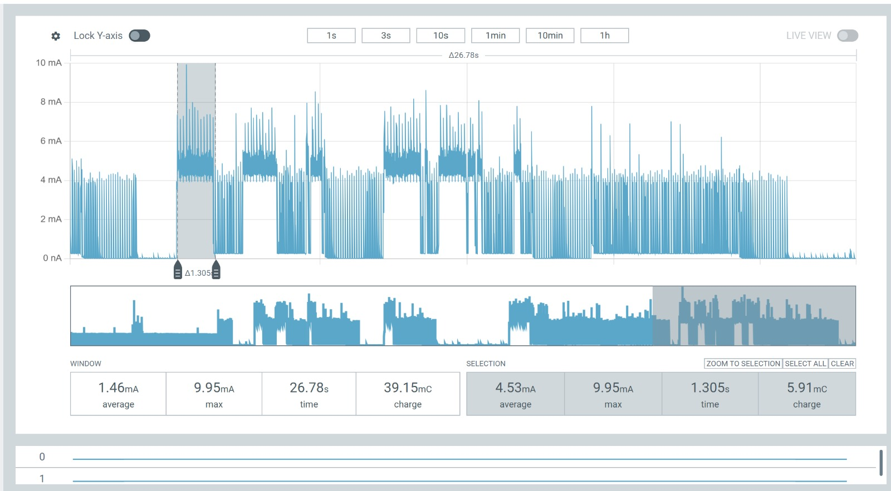

# Task 1: Train network

## Performance of the network

The collected dataset consisted of 148 readings for left tilt, 148 readings for right tilt, and 135 readings for the straight orientation. An ANN was trained using these data to classify the Puck's orientation into three classes: left, right, and straight. The trained model achieved a test accuracy of 86.2% (75 out of 87 predictions correct). The confusion matrix shows that most samples were correctly classified, with 25/30 left, 27/30 right, and 23/27 straight samples predicted correctly.

## Which one would be more energy efficient – running the ANN on-board (Variant 1) or offboard (Variant 2)?

Variant 1 is likely more energy efficient because BLE communication can consume more energy than running a lightweight ANN. However, the actual result depends on the ANN's computational cost, the BLE advertising frequency, and how much data Variant 2 transmits.

---

# Task 2: Network on Puck

## 1. Estimation of the power consumption

The Puck sleeps with the accelerometer armed for wake-on-motion, drawing about 20 µA. When it is shaken, the accelerometer interrupt wakes the nRF52, which then reads one instantaneous sample (ax, ay, az). I assume the CPU draws about 3.5 mA while active, as given on the Espruino Puck.js power page.

The network has 3 inputs, a hidden layer of 8 neurons and 3 outputs. That is 3×8 + 8×3 = 48 multiply-accumulate operations, plus 8 hidden activations and an argmax over the 3 outputs. Espruino interprets JavaScript, so we assume roughly 50-100 µs per operation including loop and array overhead. That gives an estimated inference time of about 5-10 ms, plus about 2-5 ms for wake-up and the accelerometer read, so about 10-15 ms of CPU activity in total.

The energy for this phase is E = I × V × t = 3.5 mA × 3 V × 12 ms ≈ 0.13 mJ, or about 42 µC of charge.

After inference, the Puck advertises the 1-byte prediction for 5 s. With an assumed advertising interval of 375 ms, that is about 13 advertising events. At roughly 7 mA for about 2 ms each, the charge is 13 × 7 mA × 2 ms ≈ 0.18 mC. Adding the sleep-level baseline of about 20 µA over 5 s (0.1 mC), the 5 s window costs about 0.28 mC, or about 0.85 mJ at 3 V.

Total per event: about 0.13 mJ for inference plus about 0.85 mJ for advertising, so roughly 1 mJ. Inference makes up about 13% of the event, and the advertising window dominates.

## 2. Interpretation of the power consumption measurements

**Measurement:**

- **Measured (PPK, 26.78 s window):** 2.06 mA average, 7.90 mA peak, 55.19 mC total.
- **Active phase (2.766 s selection):** 4.31 mA average, 7.54 mA peak, 11.93 mC.
- **Sleep:** Current drops to about 0 nA between activity, consistent with the ~20 µA estimate.
- **Peak:** About 7.5 mA matches the estimated ~7 mA radio current.
- **Advertising cost:** At ~4.3 mA, a 5 s window costs about 21 mC (~65 mJ), roughly 75× my 0.28 mC estimate, likely because the real advertising interval is much shorter than the assumed 375 ms.

The 7.54 mA peak matches the assumed ~7 mA radio current, and the near-0 flat section is consistent with a very low sleep baseline. However, the active phase averages about 4.3 mA (11.93 mC over 2.766 s), so a 5 s advertising window would cost roughly 20 mC (about 65 mJ), around 75 times my 0.28 mC estimate. The likely cause is a much shorter advertising interval than the 375 ms we predicted, so the advertising window dominates even more strongly than predicted, while inference remains negligible.

---

# Task 3: Offboard model

## 1. Estimation of the power consumption

In T2, the Puck sleeps at about 20 µA until a shake wakes it. It then spends about 12 ms of CPU activity at about 3.5 mA (wake-up, one accelerometer read, and 48 multiply-accumulates for the 3-8-3 network), which costs about 0.13 mJ at 3 V. It then advertises the 1-byte prediction for 5 s: about 13 events of roughly 7 mA for 2 ms add up to about 0.18 mC, plus about 0.1 mC of baseline current, so about 0.28 mC or 0.85 mJ. The total per event is about 1 mJ, and the advertising window makes up about 85% of it.

In T3, no network runs on the Puck, so only the wake-up and sensor readings remain (about 4 ms at 3.5 mA, or about 0.04 mJ). The 12-byte payload adds only about 80 µs of airtime per event, so advertising costs about 0.87 mJ, and the total per event is about 0.9 mJ. I therefore expect the two variants to differ by only about 10-15%, with T3 slightly lower, because the 5 s advertising window dominates in both and the cost of the on-board inference is small compared with the radio. If your P1.T3 code updates the payload every 100 ms, T3 will cost a little more than this estimate because of the extra CPU wake-ups.

## 2. Interpretation of the power consumption measurements

**Measurements:**

- **Whole window:** 2.06 mA average, 7.90 mA peak, 55.19 mC total.
- **Activity pattern:** An active block of about 5-6 s (dense bursts, 4 mA plateaus, spikes to 6-8 mA), then about 11 s near 0 nA, then another active block. The log markers (DUT ON at 13:54:50, OFF at 13:54:58, ON at 13:55:00) show the activity is tied to wake-ups.
- **Active section (2.766 s selection):** 4.31 mA average, 7.54 mA peak, 11.93 mC. Extrapolated to a 5 s advertising window, that is about 20 mC (about 60 mJ at 3 V).
- **Idle:** Near 0 nA, which is consistent with a very low sleep current, but the scale can't resolve 20 µA.

The measured power consumption was much higher than estimated. The active section averaged 4.31 mA, which would consume about 65 mJ over 5 seconds at 3 V, compared with the estimated 1 mJ. This suggests that the estimate missed additional activity, such as repeated processing or sensor readings, although the measurement cannot identify each component's contribution. The near-zero intervals also do not confirm the expected sleep current if "DUT OFF" means the power supply was switched off. Separate measurements of T2 and T3 are needed to check whether T3 actually consumes 10–15% less energy.

## 3. Question P2.Q1: Explain the difference or lack of it in power consumption between Task 2 and Task 3.

Task 2 and Task 3 have similar expected power consumption because both keep the Puck active and advertising for 5 seconds after wake-up. In Task 2, the Puck performs the small 3–8–3 ANN locally and sends a 1-byte prediction. In Task 3, the laptop performs the inference, but the Puck sends 12-byte accelerometer data and takes readings every 100 ms.

The local inference is estimated to cost only about 0.13 mJ. In comparison, the measured active section averaged 4.31 mA over 2.766 s, which extrapolates to about 65 mJ over 5 s at 3 V. Thus, removing inference in Task 3 should save only a very small proportion of the total energy. At the same time, Task 3's larger payload and repeated sensor readings may offset this saving.

Therefore, we expect the difference to be small, with Task 3 potentially slightly higher due to repeated sensing and advertising of more data. However, the reported measurements are the same for both tasks, so a measured difference cannot be established. Separate measurements are needed to confirm whether Task 3 consumes more, less, or approximately the same energy as Task 2.

## 4. Optional Question P2.Q2: How would the energy consumption change when the ANN becomes more complex or more data is required to be sent?

### More complex ANN

- **In T2 (ANN on the Puck):** more neurons and layers generally require more calculations and memory accesses, increasing energy per prediction.
- **In T3 (ANN on the PC):** increasing ANN complexity mainly increases the PC's energy consumption. The Puck's consumption should remain approximately unchanged if it collects and sends exactly the same data. This follows the distinction between local computation and offloaded processing.

### More data transmitted

Larger payloads or more frequent transmissions generally increase the Puck's energy consumption because the radio must transmit for longer or more often. The increase is not necessarily proportional to payload size because communication also has overhead. arxiv+1

### Overall trade-off

- A complex ANN can favour PC-based inference by avoiding expensive computation on the Puck.
- Large raw-data transfers can favour on-Puck inference, because sending only a small classification result may save more energy than the inference consumes.

The better option depends on the balance between computation and communication costs.
